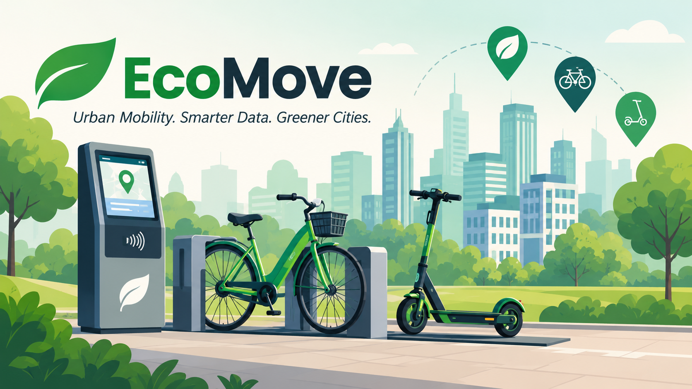
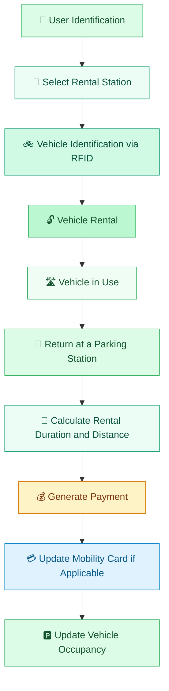
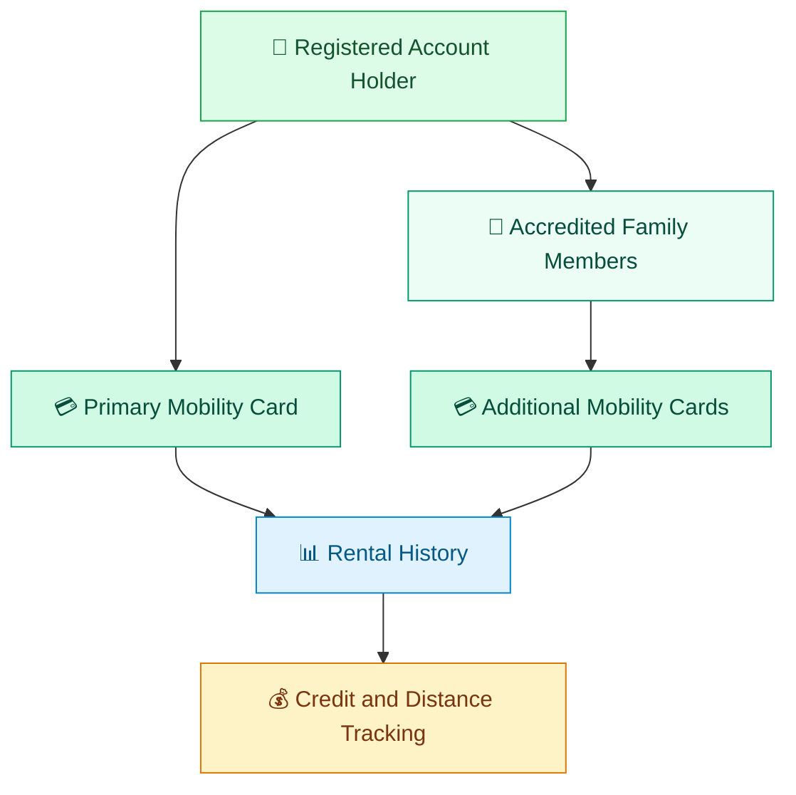
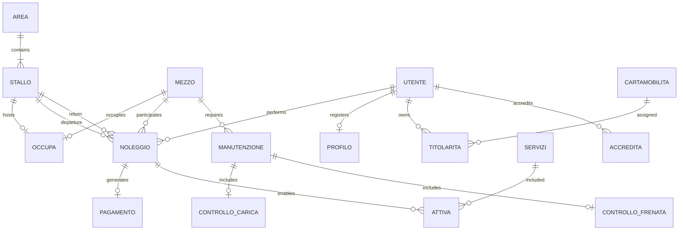

# EcoMove
### Urban Mobility. Smarter Data. Greener Cities.

<p align="center">
  <strong>A relational database designed to manage a distributed urban bike and e-scooter sharing system.</strong>
</p>

<p align="center">
  
  
  
  
</p>

---

## 🌱 Overview

**EcoMove** is a relational database project designed to support the management of a distributed urban mobility sharing service.

The system manages a network of traditional bicycles, electric bicycles and electric scooters distributed across multiple areas of a city.

Its main purpose is to provide a structured and reliable data infrastructure for managing vehicle rentals, user accounts, mobility cards, payments, parking stations and maintenance operations.

By organizing all these elements into a relational database, EcoMove provides a foundation for monitoring vehicle availability, tracking rental activity and supporting sustainable urban transportation.

---

## 🚲 The Ecosystem

The system is designed around a distributed network of vehicles and rental stations.

<p align="center">
  
</p>

### The mobility network

| Component | Description |
|---|---|
| 🚲 Traditional bicycles | Non-electric vehicles available for rental. |
| ⚡ Electric bicycles | Pedal-assisted bicycles distributed across the city. |
| 🛴 Electric scooters | Electric vehicles available at designated stations. |
| 📍 Urban areas | Geographic zones containing multiple rental stations. |
| 🅿️ Parking stations | Individual docking points where vehicles can be collected and returned. |

### Project scale

The database design considers a large-scale urban mobility scenario.

| Metric | Estimated volume |
|---|---:|
| Urban areas | 200 |
| Parking stations | 6,000 |
| Vehicles | 3,000 |
| Registered users | 200,000 |
| Potential citizens | 2,000,000 |
| Annual rentals | 10,000,000 |

<sub>These figures represent the project's estimated workload and design assumptions, not measured production data.</sub>

---

## ✨ Core Features

<table>
<tr>
<td width="50%" valign="top">

### 🚲 Fleet Management

Management of traditional bicycles, electric bicycles and electric scooters through unique RFID identifiers.

</td>
<td width="50%" valign="top">

### 📍 Station Management

Organization of urban areas and their parking stations, including vehicle availability and occupancy.

</td>
</tr>
<tr>
<td width="50%" valign="top">

### 👤 User Management

Registration and management of users, including registered account holders and users accredited through another account.

</td>
<td width="50%" valign="top">

### 💳 Mobility Cards

Management of prepaid mobility cards, ownership relationships, remaining credit and rental history.

</td>
</tr>
<tr>
<td width="50%" valign="top">

### 🔄 Rental Tracking

Recording of vehicle collection and return operations, rental duration, distance travelled and departure and arrival stations.

</td>
<td width="50%" valign="top">

### 💰 Payment Management

Tracking of rental costs, payment status and automatic updates to mobility card balances.

</td>
</tr>
<tr>
<td width="50%" valign="top">

### 🔧 Maintenance Management

Periodic vehicle inspections and monitoring of battery deterioration and brake wear.

</td>
<td width="50%" valign="top">

### ⚙️ Database Automation

SQL triggers that automate operational updates and maintain consistency across related records.

</td>
</tr>
</table>

---

## 🔄 How the System Works

The database supports the complete lifecycle of a vehicle rental.



### 01 — User identification

Users can access the service in two different ways:

- **Registered users:** have an account and one or more associated Mobility Cards.
- **Non-registered users:** can access the rental service through electronic identity verification at the rental stations.

### 02 — Vehicle rental

Each vehicle is identified through an RFID code read during rental and return operations.

The database records the user, vehicle, rental date and departure station.

### 03 — Vehicle return

A vehicle can be returned to a different station from the one where it was collected.

The system records the return date, destination station and distance travelled.

### 04 — Payment processing

The rental price is calculated according to the rental duration.

Registered users can benefit from discounts and use their prepaid Mobility Card credit.

### 05 — Data updates

The database automatically updates relevant information through SQL triggers, including rental statistics, card balances and vehicle occupancy.

---

## 💳 Mobility Card System

One of the central elements of EcoMove is the **Mobility Card**, a prepaid card associated with a user.

It allows registered users to monitor their mobility activity and manage their available credit.

### Card capabilities

- Prepaid credit management.
- Rental history tracking.
- Total distance travelled.
- Number of rentals completed.
- Card activation and blocking status.
- Historical tracking of previously owned cards.

### Family account management

A registered account holder can also request additional Mobility Cards for family members.

The system maintains the relationship between the account holder and accredited users, allowing the owner to manage the associated cards and their status.



---

## 🏗️ Database Architecture

EcoMove is based on a relational database model.

The design identifies the main entities, their attributes, primary keys and relationships, translating the conceptual structure into a relational schema.

### Main entities

| Entity | Responsibility |
|---|---|
| `Area` | Represents an urban rental zone. |
| `Stallo` | Represents a vehicle parking station. |
| `Mezzo` | Stores vehicle identification and type. |
| `Manutenzione` | Records vehicle maintenance operations. |
| `Controllo_carica` | Stores battery inspection data. |
| `Controllo_frenata` | Stores brake inspection data. |
| `Cittadino` | Represents citizen registry information. |
| `Utente` | Stores users authorized to access the service. |
| `Profilo` | Stores registered account information. |
| `Cartamobilita` | Manages prepaid mobility cards. |
| `Noleggio` | Records vehicle rental operations. |
| `Pagamento` | Tracks rental payments. |
| `Servizi` | Represents optional rental services. |

### Relationship entities

The relational schema also includes:

- `Accredita` – relationships between users.
- `Attiva` – services associated with rentals.
- `Occupa` – vehicle occupancy of parking stations.
- `Titolarita` – ownership of Mobility Cards.
- `Parentela` – family relationships between citizens.

### Conceptual relationship diagram



<sub>Simplified conceptual overview based on the documented entities and relationships. Optional and mandatory participation rules are defined in the detailed relational design.</sub>

---

## 🧩 Relational Schema

The conceptual model is translated into a relational schema using primary keys and foreign keys to represent entity identification and relationships.

The principal tables are:

| Table | Primary key |
|---|---|
| `Area` | `id_area` |
| `Stallo` | `id_stallo`, `id_area` |
| `Mezzo` | `rfid` |
| `Manutenzione` | `rfid`, `data` |
| `Controllo_carica` | `rfid`, `data` |
| `Controllo_frenata` | `rfid`, `data` |
| `Utente` | `cie` |
| `Profilo` | `username` |
| `Cartamobilita` | `id_carta` |
| `Noleggio` | `data_ora`, `id_utente` |
| `Pagamento` | `data_ora`, `id_utente` |
| `Servizi` | `id_servizio` |
| `Accredita` | `cie`, `cie_afferente` |
| `Attiva` | `data_ora`, `id_utente`, `id_servizio` |
| `Occupa` | `rfid`, `stallo`, `area` |
| `Titolarita` | `cie`, `id_carta` |
| `Cittadino` | `cf` |
| `Parentela` | `dichiarante`, `componente` |

The schema uses:

- **Primary Keys (PK)** to uniquely identify records.
- **Foreign Keys (FK)** to enforce referential integrity.
- **Composite Keys** to identify records through multiple attributes.
- **Indexes and Unique Constraints** to support data retrieval and enforce uniqueness.

---

## ⚙️ Database Automation — SQL Triggers

EcoMove uses database triggers to automate operations that occur during the rental and payment lifecycle.

The documented triggers include:

### Rental-related triggers

| Trigger | Operation |
|---|---|
| `CARTAMOBILITA_INCREMENTO_KM` | Updates the total kilometres of a registered user's active Mobility Card when a rental is completed. |
| `AREA_INC` | Increments the rental count associated with the departure area. |
| `PAGAMENTO_up_consegna_noleggio` | Creates a payment record when a vehicle is returned. |
| `UTENTE_AGGIORNAMENTO_NOLEGGI` | Updates the rental count associated with a registered user's Mobility Card. |
| `STALLO_SBLOCCA_BICI` | Removes the vehicle from its previous parking station when a rental starts. |
| `STALLO_BLOCCA_BICI` | Associates the returned vehicle with its destination station. |

### Payment-related triggers

| Trigger | Operation |
|---|---|
| `PAGAMENTO_EFFETTUATO` | Updates the remaining Mobility Card credit after a successful payment, subject to the available balance. |

These mechanisms reduce the need for manual updates and help maintain consistency between related database records.

---

## 📈 Workload Analysis & Optimization

The database design also considers the expected operational workload of the mobility service.

### Main operations

| Operation | Description | Estimated frequency |
|---|---|---:|
| O1 | Register a new user | 10/day |
| O2 | Register a user with an account | 20/day |
| O3 | Register an accredited user | 4/day |
| O4 | Create a vehicle rental | 40/day |
| O5 | Process a payment | 40/day |
| O6 | Check rental statistics by area | 1/day |
| O7 | Send a vehicle for maintenance | 10/month |

### Redundancy analysis

One of the analyzed optimization choices concerns the `totale_noleggi` attribute in the `Area` table.

This value can be calculated dynamically by counting the rentals associated with an area.

However, storing the total directly in the `Area` table allows rental statistics to be retrieved without repeatedly scanning the large `Noleggio` table.

The project evaluates the trade-off between:

- Additional storage requirements.
- Read operations required for statistical queries.
- Write operations needed to keep the redundant value updated.

The documented analysis supports retaining this attribute and maintaining it through the `AREA_INC` trigger.

---

## 🔧 Maintenance Management

Vehicle maintenance is an important part of the system.

The database distinguishes between electric and non-electric vehicles and stores the corresponding inspection information.

| Vehicle type | Maintenance interval | Inspection data |
|---|---|---|
| Electric bicycles | Every 2 months | Battery deterioration |
| Electric scooters | Every 2 months | Battery deterioration |
| Traditional bicycles | Every 3 months | Front and rear brake wear |

The system maintains historical maintenance records through the `Manutenzione` table.

Additional inspection data is stored in:

- `Controllo_carica` – battery identification and deterioration level.
- `Controllo_frenata` – wear levels for front and rear brakes.

This structure makes it possible to track the condition of each vehicle over time.

---

## 🛠️ Technology

The project focuses on relational database design and SQL-based database management.

| Technology / Concept | Purpose |
|---|---|
| SQL | Database definition and manipulation |
| MySQL-compatible SQL | Relational database implementation syntax |
| Entity-Relationship Model | Conceptual data modeling |
| Relational Model | Database schema definition |
| Primary & Foreign Keys | Data integrity |
| Indexes & Constraints | Data consistency and query support |
| SQL Triggers | Automatic database operations |

---

## 📂 Repository Structure

```text
Progetto-Database/
│
├── Progetto_Database_file/
│
├── Progetto_Database.htm
│
└── README.md
```

### Project documentation

The repository includes the detailed project report, containing the extended analysis, design decisions, relational model, SQL definitions and trigger documentation.

📄 [View the detailed project report](./Progetto_Database.htm)

---

## 🎯 Project Goals

EcoMove aims to provide a structured data model for a sustainable urban mobility service.

Its main goals are:

- Organize a distributed fleet of shared vehicles.
- Manage users, accounts and prepaid mobility cards.
- Track rentals across different urban areas.
- Maintain accurate payment and rental records.
- Monitor vehicle availability and parking station occupancy.
- Schedule and document vehicle maintenance.
- Automate recurring database operations.
- Support large-scale data management through relational modeling and optimization.

---

## 👩‍💻 Author

**Allegra Salvatore**

---

<p align="center">
  <strong>EcoMove</strong>
  <br />
  <em>Building the data infrastructure for greener cities.</em>
  <br /><br />
  <a href="https://github.com/AllegraSalvatore/Progetto-Database">View Repository</a>
</p>
